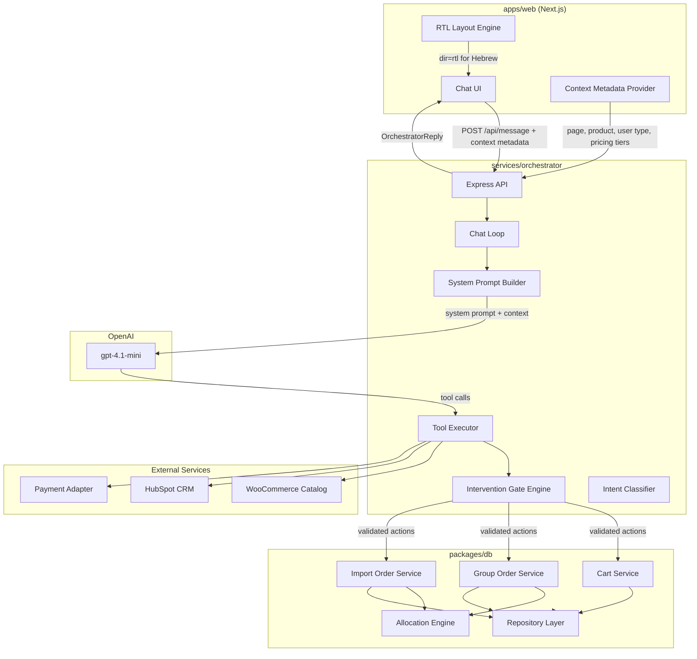
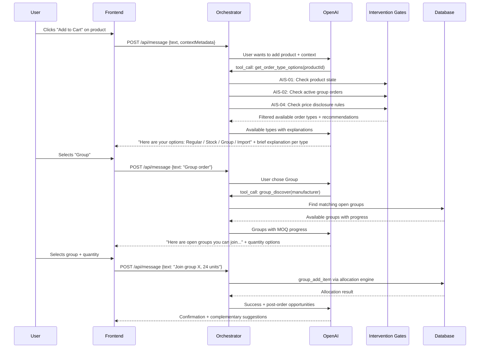
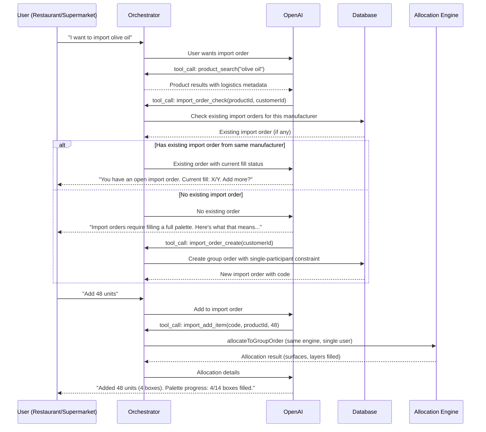

# Design Document: TasteLabs Agent M2

## Overview

TasteLabs Agent M2 evolves the existing conversational commerce agent into a fully context-aware, multi-order-type shopping assistant. The current system supports regular cart operations and group orders with surface/layer allocation. M2 extends this with: (1) a new "Import" order type that reuses group order palette rules for a single user, (2) an order-type selection flow that guides users through Regular, Stock, Group, and Import options with type-specific UX, (3) an Intervention Logic Gate system (AIS-01 through AIS-08) that enforces optimal purchase paths and prevents suboptimal decisions, (4) proactive culinary cross-selling, (5) Hebrew-first RTL language support, and (6) anti-spam guardrails.

The design builds on the existing monorepo architecture: `apps/web` (Next.js), `services/orchestrator` (Express + OpenAI tool-calling loop), `packages/db` (Prisma + group order allocation), and `packages/shared` (shared types). All new features integrate into the existing tool-calling chat loop and surface/layer allocation engine.

## Architecture

### System Overview



### Order Type Selection Flow



### Import Order Flow



## Components and Interfaces

### Component 1: Intervention Gate Engine

**Purpose**: Enforces all AIS-01 through AIS-08 intervention protocols before the agent recommends purchase paths. Sits between the tool executor and the business logic, filtering and redirecting actions based on product state, active orders, and session context.

**Interface**:
```typescript
interface InterventionGateEngine {
  evaluateOrderTypeOptions(
    productId: string,
    customerId: string,
    sessionContext: SessionContext
  ): Promise<OrderTypeRecommendation>;

  checkPriceDisclosure(
    product: ProductWithState,
    orderType: OrderType
  ): PriceDisclosureResult;

  evaluateShareSuggestion(
    sessionContext: SessionContext
  ): ShareSuggestionResult;

  getCulinaryRecommendations(
    cookingContext: string,
    catalogProducts: ProductCard[]
  ): CulinaryRecommendation[];
}
```

**Responsibilities**:
- AIS-01: Verify product state (ACTIVE_IMPORTED vs CATALOG_EXTENSION) before suggesting purchase paths
- AIS-02: Check for active group orders and recommend group over individual when beneficial
- AIS-03: Block suboptimal paths (low-volume wholesale, mismatched group orders)
- AIS-04: Enforce price disclosure rules (no prices for Dream List, clear pricing for ACTIVE_IMPORTED)
- AIS-05: Handle Dream List activation flow (explain stage, what's needed to progress)
- AIS-06: Provide order status and action options on status queries
- AIS-07: Drive culinary context-based recommendations
- AIS-08: Cart management with total and minimum order validation

### Component 2: Order Type Router

**Purpose**: Manages the order type selection flow. When a user wants to add a product, this component determines which order types are available and presents type-specific options.

**Interface**:
```typescript
interface OrderTypeRouter {
  getAvailableOrderTypes(
    productId: string,
    customerId: string
  ): Promise<AvailableOrderTypes>;

  getRegularOrderOptions(productId: string): RegularOrderOptions;

  getStockOrderOptions(productId: string): StockOrderOptions;

  getGroupOrderOptions(
    productId: string,
    customerId: string
  ): Promise<GroupOrderOptions>;

  getImportOrderOptions(
    productId: string,
    customerId: string
  ): Promise<ImportOrderOptions>;
}
```

**Responsibilities**:
- Determine which order types are available for a given product
- Provide type-specific quantity constraints (no MOQ for regular, MOQ for stock, palette rules for group/import)
- Surface existing open group/import orders the user can join or continue
- Provide brief explanations and process walkthroughs per order type

### Component 3: Import Order Service

**Purpose**: Manages import orders, which follow the same palette/surface/layer allocation rules as group orders but are restricted to a single participant. Primarily for restaurants and supermarkets.

**Interface**:
```typescript
interface ImportOrderService {
  createImportOrder(
    customerId: string,
    deadlineHours?: number
  ): Promise<ImportOrder>;

  getOpenImportOrders(
    customerId: string,
    manufacturerId?: string
  ): Promise<ImportOrder[]>;

  addItemToImportOrder(
    code: string,
    customerId: string,
    product: ProductLogistics,
    quantityUnits: number
  ): Promise<AllocationResult>;

  getImportOrderStatus(code: string): Promise<ImportOrderStatus>;

  checkoutImportOrder(code: string, customerId: string): Promise<CheckoutResult>;
}
```

**Responsibilities**:
- Create group orders with `isImport: true` flag and single-participant constraint
- Reuse the existing `allocateToGroupOrder` engine for palette filling
- Enforce that only the creating user can add items
- Track palette fill progress and notify when palette is complete

### Component 4: Context Metadata Provider (Frontend)

**Purpose**: Enriches every agent request with page-level and product-level context so the agent can make informed decisions without extra round-trips.

**Interface**:
```typescript
interface ContextMetadata {
  currentPage: 'catalog' | 'product_detail' | 'cart' | 'checkout' | 'group_orders' | 'profile';
  product?: {
    id: string;
    name: string;
    manufacturer: string;
    state: 'ACTIVE_IMPORTED' | 'CATALOG_EXTENSION';
    pricingTiers: {
      retail?: string;
      wholesale?: string;
      importPerSurface?: string;
      importPer2Boxes?: string;
    };
    dreamStage?: string;
  };
  activeGroupOrder?: {
    code: string;
    manufacturer: string;
    progress: number;
    participantCount: number;
    daysLeft: number;
  };
  userType: 'private_consumer' | 'retailer';
}
```

**Responsibilities**:
- Detect current page and extract relevant product/order context
- Pass user type (private consumer vs retailer) for order type filtering
- Include active group order metrics for intervention gate decisions
- Include pricing tiers so the agent can present correct prices per order type

### Component 5: Language & RTL Handler

**Purpose**: Detects conversation language and ensures Hebrew responses are RTL-aligned. The system defaults to Hebrew, with English available for developer convenience.

**Interface**:
```typescript
interface LanguageHandler {
  detectLanguage(text: string): 'he' | 'en';
  getLanguageInstruction(detectedLang: 'he' | 'en'): string;
  applyRTL(response: string, lang: 'he' | 'en'): FormattedResponse;
}
```

**Responsibilities**:
- Detect input language (Hebrew vs English) from user message
- Prepend language instruction tag `[LANGUAGE: he]` or `[LANGUAGE: en]` to messages sent to the LLM
- Frontend applies `dir="rtl"` and right-alignment for Hebrew responses
- Product names remain in their original catalog language regardless of conversation language

### Component 6: Anti-Spam Guardrails

**Purpose**: Enforces session-level limits on share suggestions and prevents pressure tactics.

**Interface**:
```typescript
interface AntiSpamGuardrails {
  canSuggestShare(sessionContext: SessionContext): boolean;
  recordShareSuggestion(sessionId: string, page: string): void;
  getSessionShareCount(sessionId: string): number;
  getPageShareCount(sessionId: string, page: string): number;
}
```

**Responsibilities**:
- Maximum 3 share suggestions per session
- Maximum 1 share suggestion per page
- No guilt language or artificial urgency in agent responses
- Natural, trust-first tone enforcement via system prompt instructions


## Data Models

### Model 1: Import Order (extends GroupOrder)

Import orders reuse the existing `GroupOrder` model with additional constraints. No new table is needed — the `GroupOrder` model gains an `isImport` flag and `orderType` enum.

```typescript
// Extension to existing GroupOrder Prisma model
enum OrderType {
  GROUP    // Multi-user, shared palette
  IMPORT   // Single-user, full palette (restaurants, supermarkets)
}

// New fields on GroupOrder model
model GroupOrder {
  // ... existing fields ...
  orderType    OrderType  @default(GROUP)
  isImport     Boolean    @default(false)
  maxParticipants  Int?   // null = unlimited (group), 1 = import
}
```

**Validation Rules**:
- If `isImport = true`, `maxParticipants` must be 1
- If `isImport = true`, only the `createdByCustomerId` can add items
- Same surface/layer allocation rules apply as group orders
- Same manufacturer constraint applies (one manufacturer per import order)

### Model 2: Order Type Options

```typescript
interface AvailableOrderTypes {
  productId: string;
  productName: string;
  productState: 'ACTIVE_IMPORTED' | 'CATALOG_EXTENSION';
  manufacturer: string;
  types: OrderTypeOption[];
}

interface OrderTypeOption {
  type: 'regular' | 'stock' | 'group' | 'import';
  available: boolean;
  recommended: boolean;
  reason?: string;           // Why recommended or unavailable
  pricePerUnit?: string;     // Type-specific pricing
  moq?: number;              // Minimum order quantity (stock: boxes, group/import: surfaces)
  existingOrders?: {         // Open orders user can join/continue
    code: string;
    progress: string;        // e.g. "4/14 boxes filled"
    daysLeft?: number;
  }[];
}
```

**Validation Rules**:
- Regular: always available for ACTIVE_IMPORTED products with retail price
- Stock: available when product has wholesale price and MOQ metadata
- Group: available when product has logistics metadata (unitsPerBox, boxesPerLayer, layersPerSurface)
- Import: available for retailer users when product has logistics metadata
- CATALOG_EXTENSION (Dream List) products: no order types available, only Dream List activation flow

### Model 3: Session Context (for Anti-Spam & Intervention Gates)

```typescript
interface SessionContext {
  sessionId: string;
  customerId: string;
  userType: 'private_consumer' | 'retailer';
  currentPage: string;
  shareSuggestionsCount: number;
  shareSuggestionsPerPage: Record<string, number>;
  lastInterventionGate?: string;   // Last AIS gate triggered
  cookingContext?: string;          // From AIS-07 culinary dialogue
  activeGroupOrders: string[];     // Codes of user's active group orders
  activeImportOrders: string[];    // Codes of user's active import orders
}
```

**Validation Rules**:
- `shareSuggestionsCount` must not exceed 3 per session
- `shareSuggestionsPerPage[page]` must not exceed 1 per page
- Session context is passed from frontend via `contextMetadata` on each request

### Model 4: Intervention Gate Result

```typescript
interface InterventionResult {
  gate: string;                    // e.g. "AIS-01", "AIS-02"
  action: 'allow' | 'redirect' | 'block' | 'inform';
  message?: string;                // Explanation for the user
  redirectTo?: OrderType;          // Suggested alternative order type
  data?: Record<string, unknown>;  // Gate-specific data (e.g. active group orders)
}
```

### Model 5: Pricing Tiers (per product, per order type)

```typescript
interface ProductPricingTiers {
  retail?: string;              // Regular order price (מחיר קמעונאי)
  wholesale?: string;           // Stock order price (מחיר סיטונאי)
  importPerSurface?: string;    // Import/Group price per surface (מחיר יבוא למשטח)
  importPer2Boxes?: string;     // Import/Group price per 2 boxes (מחירי יבוא לשני קרטונים)
  sale?: string;                // Promotional price (מחיר מבצע)
}
```

**Validation Rules**:
- Regular orders use `retail` price
- Stock orders use `wholesale` price (discounted)
- Group/Import orders use `importPerSurface` or `importPer2Boxes` pricing
- AIS-04: CATALOG_EXTENSION products must never show prices
- AIS-04: ACTIVE_IMPORTED products must show clear pricing for the selected order type

## Error Handling

### Error Scenario 1: Product State Mismatch (AIS-01)

**Condition**: User tries to purchase a CATALOG_EXTENSION (Dream List) product
**Response**: Agent explains the product is on the Dream List, its current stage, and what's needed to progress (AIS-05)
**Recovery**: Offer to add to Dream List wishlist, suggest similar ACTIVE_IMPORTED alternatives

### Error Scenario 2: Suboptimal Purchase Path (AIS-02, AIS-03)

**Condition**: User tries to buy individually when an active group order exists for the same manufacturer
**Response**: Agent recommends the group order, showing progress and potential savings
**Recovery**: User can override and proceed with individual purchase, but agent logs the intervention

### Error Scenario 3: Import Order Single-User Violation

**Condition**: A second user attempts to add items to an import order
**Response**: Return error explaining import orders are single-user; suggest creating a group order instead
**Recovery**: Offer to create a new group order or a separate import order

### Error Scenario 4: Palette Overflow (Import/Group)

**Condition**: User tries to add more units than the palette can hold
**Response**: Agent explains remaining capacity and suggests adjusting quantity
**Recovery**: Show exact remaining capacity per layer/surface, offer to fill to maximum

### Error Scenario 5: Missing Logistics Metadata

**Condition**: Product lacks required fields (unitsPerBox, boxesPerLayer, layersPerSurface) for group/import orders
**Response**: Agent explains the product can only be ordered as Regular or Stock
**Recovery**: Suggest regular order as fallback, flag product for admin to update metadata

### Error Scenario 6: Language Detection Failure

**Condition**: Input contains mixed Hebrew/English or ambiguous language
**Response**: Default to Hebrew (primary market language)
**Recovery**: User can explicitly switch language; agent follows the last detected language

## Testing Strategy

### Unit Testing Approach

- Intervention Gate Engine: Test each AIS gate independently with mock product states and session contexts
- Order Type Router: Test availability logic for each product state × user type combination
- Import Order Service: Test single-participant constraint enforcement
- Anti-Spam Guardrails: Test session-level and page-level share suggestion limits
- Language Detection: Test Hebrew, English, and mixed-language inputs
- Allocation Engine: Existing tests cover surface/layer allocation; extend for import order constraints

### Property-Based Testing Approach

**Property Test Library**: fast-check

- Allocation invariant: For any valid product logistics and quantity, allocated units never exceed requested units
- Import order invariant: Import orders never have more than 1 participant
- Anti-spam invariant: Share suggestions per session never exceed 3, per page never exceed 1
- Price disclosure invariant: CATALOG_EXTENSION products never have prices in agent responses
- Order type availability: Regular orders are always available for ACTIVE_IMPORTED products with retail price

### Integration Testing Approach

- End-to-end order type selection flow: product search → type selection → type-specific options → add to order
- Group order discovery and join flow with intervention gates
- Import order creation, filling, and checkout flow
- Hebrew conversation flow with RTL rendering verification
- Cross-selling after order placement with anti-spam limits

## Performance Considerations

- Context metadata is passed from frontend on each request, avoiding extra DB lookups for page/product state
- Intervention gates run in parallel where possible (AIS-01 and AIS-02 can evaluate concurrently)
- Import orders reuse the existing allocation engine — no new allocation code path needed
- Session context (anti-spam counters) stored in-memory on the frontend and passed per request, avoiding session storage overhead
- Group order discovery queries are already indexed on `manufacturerId` and `status`

## Security Considerations

- Anti-spam guardrails are enforced server-side (not just frontend) to prevent bypass
- Import order single-participant constraint enforced at the database level (check `createdByCustomerId` before allowing item additions)
- Price disclosure rules (AIS-04) enforced in the tool executor before returning data to the LLM, preventing accidental price leaks for Dream List items
- Ground truth enforcement: Agent never invents products; all product data comes from WooCommerce/HubSpot catalog lookups
- Session share counters validated server-side to prevent manipulation

## Dependencies

- **Existing**: OpenAI SDK (gpt-4.1-mini), Prisma ORM, Express, WooCommerce REST API, HubSpot REST API, Next.js 14
- **No new external dependencies required** — all M2 features build on existing infrastructure
- **Prisma migration**: Add `orderType`, `isImport`, `maxParticipants` fields to `GroupOrder` model
- **System prompt update**: Extend `buildSystemPrompt` with intervention gate instructions, order type explanations, and anti-spam rules
- **New tools**: `get_order_type_options`, `import_order_create`, `import_order_check`, `import_add_item`, `import_order_status`
